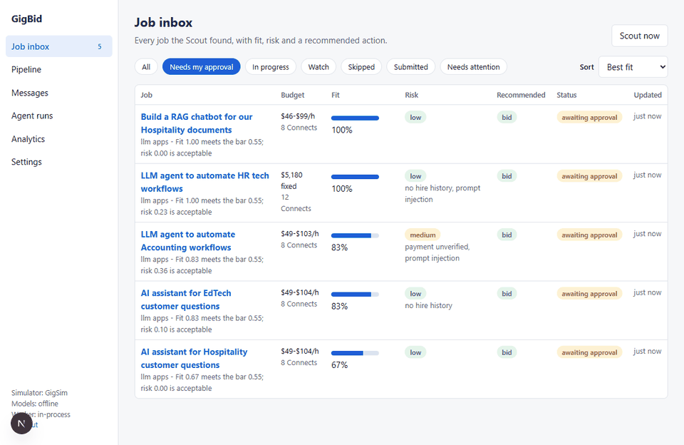
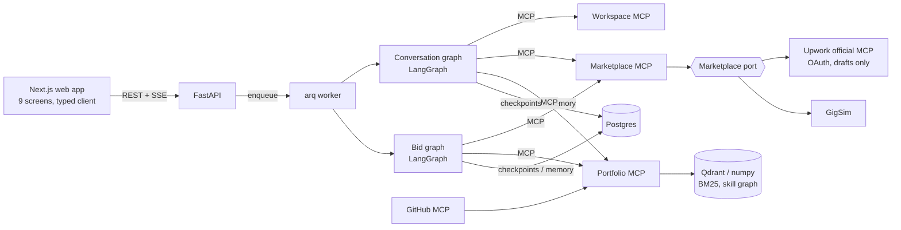

# GigBid

A multi-agent freelancer copilot (AI-4016 R&D assignment). It scouts freelance jobs, decides which
are worth bidding on, drafts proposals in which **every claim is backed by the freelancer's own
portfolio**, prices the bid against the market and the Connects it costs, and handles client
replies. **It never submits, sends or spends without the human's approval.**



Technical write-up: [Building GigBid: What Better Retrieval Actually Changed](https://medium.com/@salehamuhammad77/building-gigbid-what-better-retrieval-actually-changed-54f1a159619b).

Free UI preview: https://gigbid-preview-web-v8m9.onrender.com (deterministic offline models and temporary data; it may sleep). Reviewer login is provided in the private GCR comment. Full-stack open-model deployment instructions are in [the runbook](docs/RUNBOOK.md). Public LangSmith trace links are not supplied.

Three-minute silent demo: [download or play the MP4](https://raw.githubusercontent.com/salehamuhammad/GigBid/main/docs/images/GigBid-demo.mp4).

## Run it

```bash
pip install -e ".[dev]"
python -m scripts.generate_data && python -m scripts.seed
make web-install && python -m scripts.dev      # http://localhost:3000
```
No API key needed (`MODEL_PROFILE=offline`). For real open-weight models: `pip install -e ".[models]"`,
`MODEL_PROFILE=open`, `GROQ_API_KEY=...`. Full stack: `docker compose -f infra/docker-compose.yml up --build`.
See [docs/RUNBOOK.md](docs/RUNBOOK.md). One proposal in the terminal: `python -m scripts.demo`.

## Architecture



**Bid graph** (`agent/graphs/bid_graph.py`, rendered from code in `docs/graphs/`): intake ->
Job Analyst ‖ Risk Assessor ‖ Fit Matcher (parallel, `Send`) -> decide -> Pricing -> Writer ->
claim verifier -> Critic (sends back at most twice) -> Compliance (can block) -> **approval
interrupt** -> submit (idempotent). **Conversation graph**: load -> classify intent -> (free
slots) -> draft reply -> Compliance -> **approval interrupt** -> send (+ tentative hold).

| Agent | Job | MCP access |
|---|---|---|
| Scout | Saved searches, de-dup by content, queue | marketplace read |
| Job Analyst | JobSpec | none |
| Risk Assessor | Client quality, scams, injected instructions | marketplace read |
| Fit Matcher | Requirement -> evidence matrix, fit score | portfolio read |
| Pricing Strategist | Bid from market stats, floor, Connects EV | marketplace read |
| Proposal Writer | Cover letter + screening answers with citations | portfolio read |
| Critic | Grounding, personalisation, length | portfolio read |
| Compliance Guard | Policy pack: redact or block | none |
| Client Liaison | Intent, reply, interview slots | marketplace, workspace, portfolio |

Allowlists per agent: `agent/config.yaml` `tools.allow`. Tools: [docs/TOOLS.md](docs/TOOLS.md).
Decisions: [docs/adr/](docs/adr/). Data: [docs/DATA_CARD.md](docs/DATA_CARD.md).

## Results

Measured values below come from the evaluation files in `evals/results/`. The generated section is
rewritten by `python -m evals.runners.results_table`. Profile shown in each table header; the
`offline` profile uses heuristics instead of LLMs, so draft-quality numbers under it measure the
pipeline, not a model. Read the limitations in the data card before citing them.

The [Groq tool-design run](evals/results/tool_granularity_open_final_40.json) used 40 tasks
per tool surface on GPT-OSS 120B. The shipped descriptions reached 92.5% first-call selection
accuracy and 82.5% argument accuracy. Terse descriptions reached 85% and 77.5%. The coarse
surface reached 70% and 67.5%, with usage available for 32 of its 40 trials. An
[earlier coarse schema](evals/results/tool_granularity_open_40.json) returned HTTP 400 in
28 of 40 trials. Token averages include responses with measured usage.

The historical offline table uses the original capped-denominator retrieval score.
The current runner defines Recall@5 as the fraction of all labeled evidence retrieved in
the first five unique items. Historical scores and outputs from the current runner therefore
use different definitions.

The [BGE/Qdrant run](evals/results/rag_open_bge_qdrant_no_cross_encoder.json) includes
570 dev jobs after duplicate exclusion. Mean persona Recall@5 / nDCG@10 were
0.4382 / 0.6506 for naive dense, 0.4036 / 0.6061 for decomposition, 0.4900 / 0.7144
for hybrid and 0.5547 / 0.8099 for the skill graph. The raw file contains per-persona and
per-category results. These four variants do not use the cross-encoder.
The [six-variant follow-up](evals/results/rag_open_bge_qdrant_24.json) used the same BGE
indexes on 22 nonduplicate jobs from a 24-job sample. Hybrid reached 0.7117 nDCG@10,
cross-encoder reranking reached 0.5759, and the configured composition reached 0.6330.

The [full TinyBERT cross-encoder benchmark](evals/results/rag_full_tinybert.json)
scored seven configurations on all 570 included dev jobs with the same BGE indexes.
TinyBERT reranking reached 0.4294 Recall@5 and 0.6528 nDCG@10.
The [paired comparison](evals/results/tinybert_v3_paired_hybrid.json) found that its
nDCG@10 was 0.0617 lower than hybrid on the 461 jobs with labeled evidence.

**Retrieval selected for deployment.** The source configuration selects V9 Skill Graph.
It led the full 570-job BGE-embedding retrieval comparison. The previous BGE reranking
composition exceeded the Matcher's 90-second timeout in the
[runtime pilot](evals/results/retrieval_bge_runtime_pilot.json). The matched table below
compares V9 and V0 on the same 15 jobs, with rubric scores and GigSim simulated outcomes.
The reply rate per scored draft and replies per assigned job use different denominators.

<!-- RESULTS:START -->
**RAG variants** (all three personas, gold evidence from the dev set; profile `offline`, embeddings `{'provider': 'hash', 'model': 'hash-1024'}`, reranker `{'provider': 'lexical', 'model': 'lexical-overlap'}`)

| Variant | Recall@5 | MRR | nDCG@10 | Refusal acc. | p95 ms |
|---|---|---|---|---|---|
| v9_skill_graph | 0.7763 | 0.9271 | 0.7913 | 0.0 | 4.0333 |
| best | 0.7417 | 0.889 | 0.7382 | 0.6167 | 14.3333 |
| v3_rerank | 0.6819 | 0.9166 | 0.7003 | 0.0 | 1.0 |
| v8_corrective | 0.6967 | 0.883 | 0.6962 | 0.6167 | 9.0333 |
| v6_contextual | 0.6247 | 0.8588 | 0.6327 | 0.0 | 0.5 |
| v2_hybrid | 0.6341 | 0.848 | 0.632 | 0.0 | 0.5 |
| v4_outcome | 0.6394 | 0.8468 | 0.6269 | 0.0 | 0.9667 |
| v5_multivector | 0.6082 | 0.852 | 0.6099 | 0.0 | 0.8 |
| v7_hyde | 0.5484 | 0.8003 | 0.5762 | 0.0 | 1.5 |
| v1_decompose | 0.5526 | 0.7743 | 0.5635 | 0.0 | 1.1 |
| v0_naive | 0.5538 | 0.8005 | 0.5547 | 0.0 | 0.2 |

**Decisions and drafts** (whole bid graph)

| Persona | Bid P | Bid R | Bid F1 | Scam recall | Unsupported before | Unsupported after | p95 s | USD/job |
|---|---|---|---|---|---|---|---|---|
| all | 1.0 | 0.973 | 0.986 | 1.0 | 0.0 | 0.0 | 0.296 | 0.0 |
| ai_engineer | 1.0 | 1.0 | 1.0 | 1.0 | 0.0 | 0.0 | 0.29 | 0.0 |
| fullstack_dev | 1.0 | 1.0 | 1.0 | 1.0 | 0.0 | 0.0 | 0.251 | 0.0 |
| data_analyst | 1.0 | 0.92 | 0.958 | 1.0 | 0.0 | 0.0 | 1.455 | 0.0 |

**Prompt injection** (planted canaries)

| Defences | n | Exposed to model | Leaked into draft | Detected | Hijacked |
|---|---|---|---|---|---|
| on | 45 | 0.0 | 0.0 | 1.0 | 0.0 |
| off | 45 | 1.0 | 0.0 | 1.0 | 0.0 |

**Simulated client outcomes** (paired, same jobs)

| Arm | n | Mean P(reply) | Reply rate | Hire rate |
|---|---|---|---|---|
| generic | 74 | 0.1256 | 0.0676 | 0.0 |
| evidence_first | 74 | 0.5549 | 0.527 | 0.1892 |
| question_first | 74 | 0.556 | 0.527 | 0.1892 |

- evidence first vs generic: diff +0.429, 95% CI [0.3913, 0.4677], sign test p = 0.0 (74 wins / 0 losses)

- question first vs evidence first: diff +0.001, 95% CI [0.0, 0.0034], sign test p = 1.0 (1 wins / 0 losses)


**Ablations** (one component removed from the original composition)

| Configuration | Recall@5 | MRR | nDCG@10 | Refusal acc. |
|---|---|---|---|---|
| best (original) | 0.7424 | 0.8809 | 0.746 | 0.6333 |
| - rerank | 0.7197 | 0.8494 | 0.7321 | 0.6333 |
| - skill graph (hybrid instead) | 0.7058 | 0.8693 | 0.6957 | 0.6333 |
| - graph and BM25 (dense only) | 0.6362 | 0.8189 | 0.6291 | 0.7556 |
| - decomposition | 0.7058 | 0.9059 | 0.7126 | 0.2333 |
| - corrective loop | 0.7738 | 0.9238 | 0.7823 | 0.0 |

| Claim verification | Drafts | Claims | Unsupported reaching the human | Rate |
|---|---|---|---|---|
| verification on | 35 | 191 | 0 | 0.0 |
| verification off | 35 | 191 | 0 | 0.0 |

**Matched open-model retrieval and proposal outcomes** ([raw results](evals/results/retrieval_outcomes_open.json))

| Variant | Recall@5 | nDCG@10 | Unsupported claims/cover letter | Rubric score /5 | Replies/scored draft | Replies/assigned job | Proposal p95 (s) | USD/proposal | Drafts/jobs |
|---|---|---|---|---|---|---|---|---|---|
| v0_naive | 0.6500 | 0.6428 | 0.25 | 4.25 | 75.0% | 40.0% | 40.48 | 0.008217 | 8/15 |
| v9_skill_graph | 0.8000 | 0.8317 | 0.22 | 4.44 | 66.7% | 40.0% | 34.29 | 0.008533 | 9/15 |
<!-- RESULTS:END -->

**Multi-agent comparison (R&D question C)** and **tool granularity (R&D question A)**: run
`python -m evals.runners.baselines` and `python -m evals.runners.tool_granularity` with a real model
profile; results land in `evals/results/baselines.json` and `tool_granularity.json`.

## Repository map

```
agent/        graphs, nodes, prompts (*.md, versioned), config.yaml, memory, guardrails, model layer
rag/          loaders, chunkers, embeddings, BM25, vector store, skill graph, 10 variants, claim verification
mcp_servers/  portfolio (read-only, publishable), marketplace (port + GigSim/Upwork adapters), workspace
gigsim/       the marketplace simulator (jobs, clients, Connects, events, rate limits, policy update)
apps/api      FastAPI: auth, routers, SSE        apps/web   Next.js app + Playwright specs
worker/       arq tasks and schedules            evals/     runners, datasets, results
data/         personas, policy pack, GigSim seed infra/     Dockerfiles, compose, Render blueprint
```
